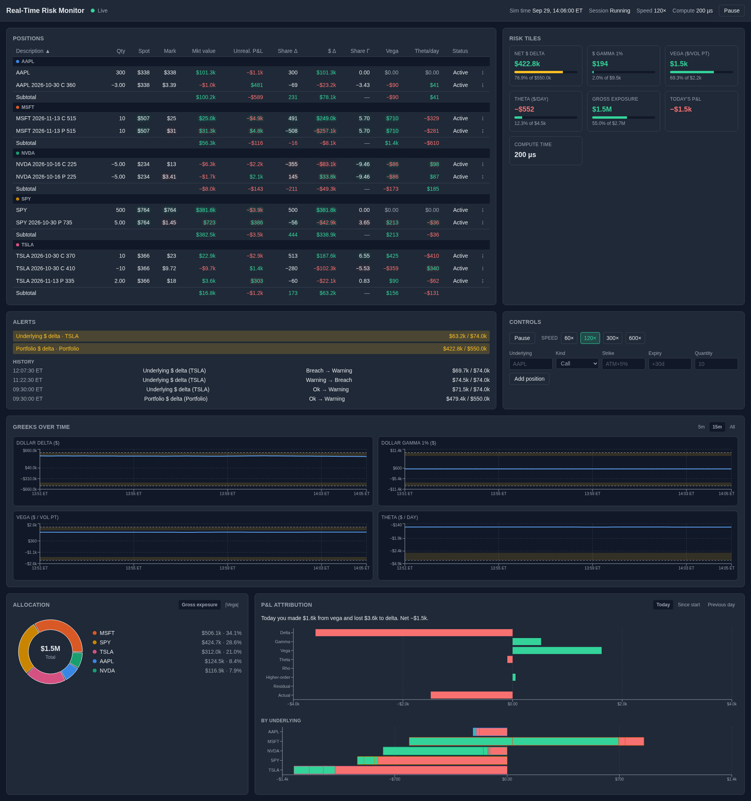
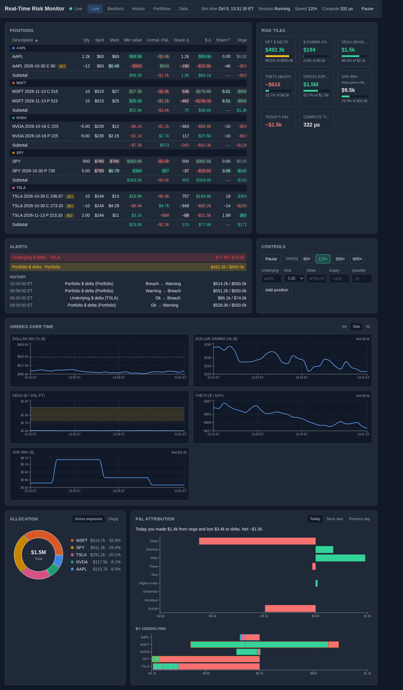
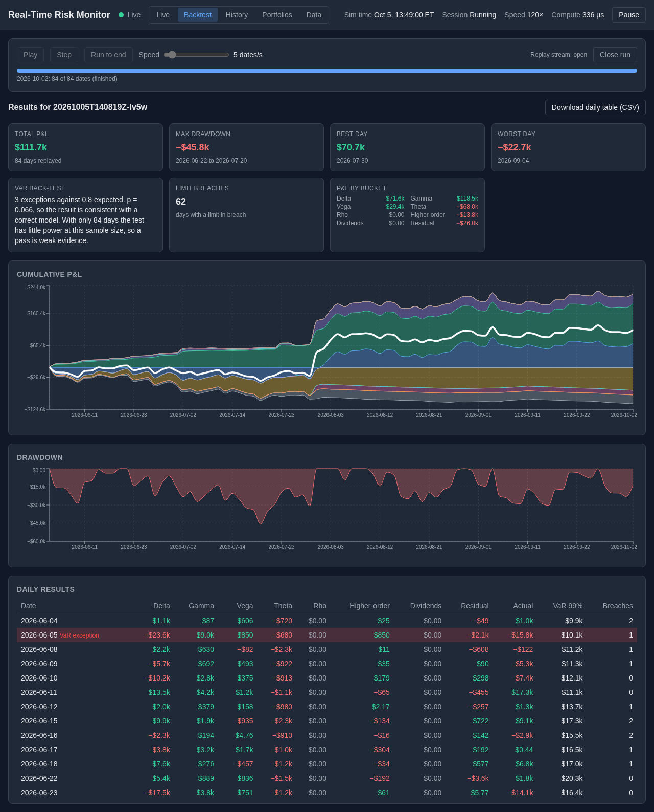
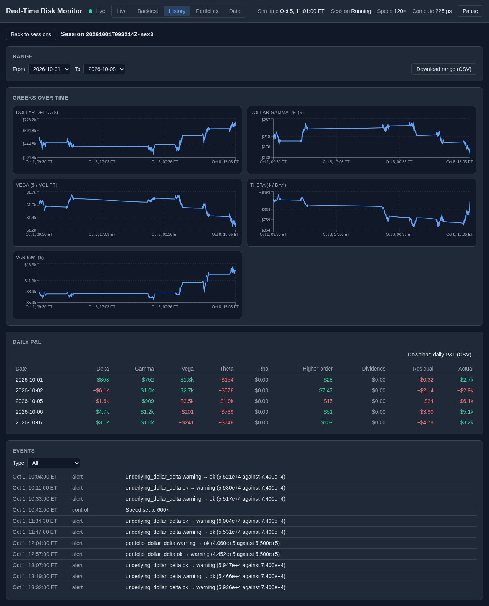
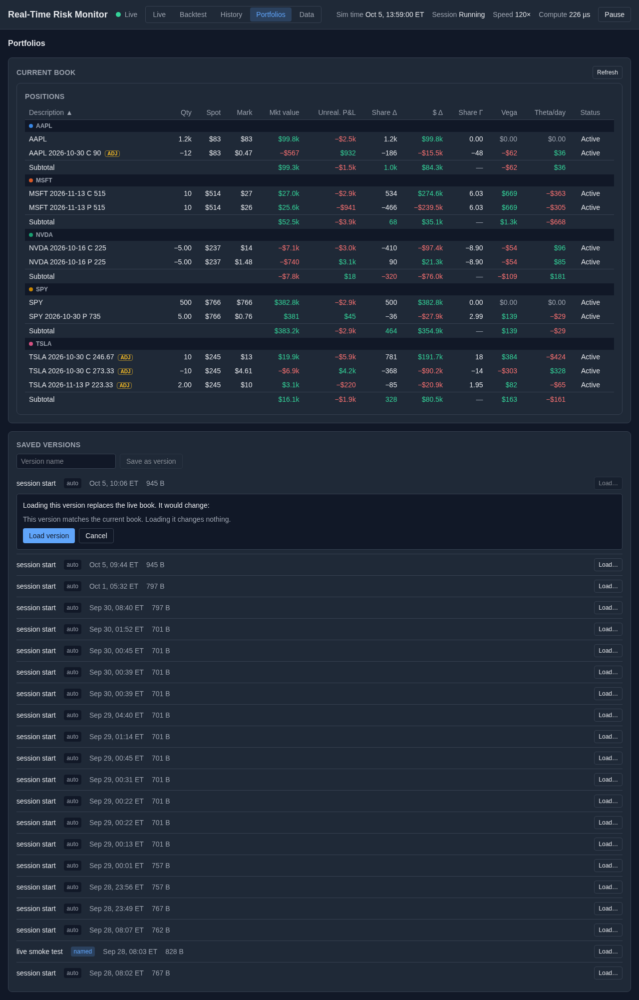
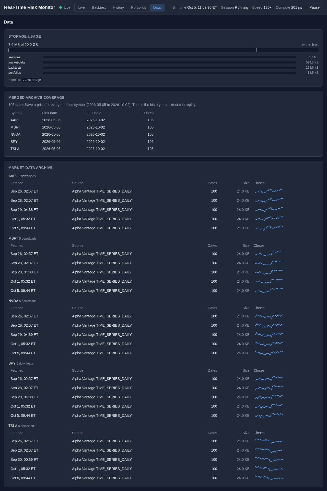
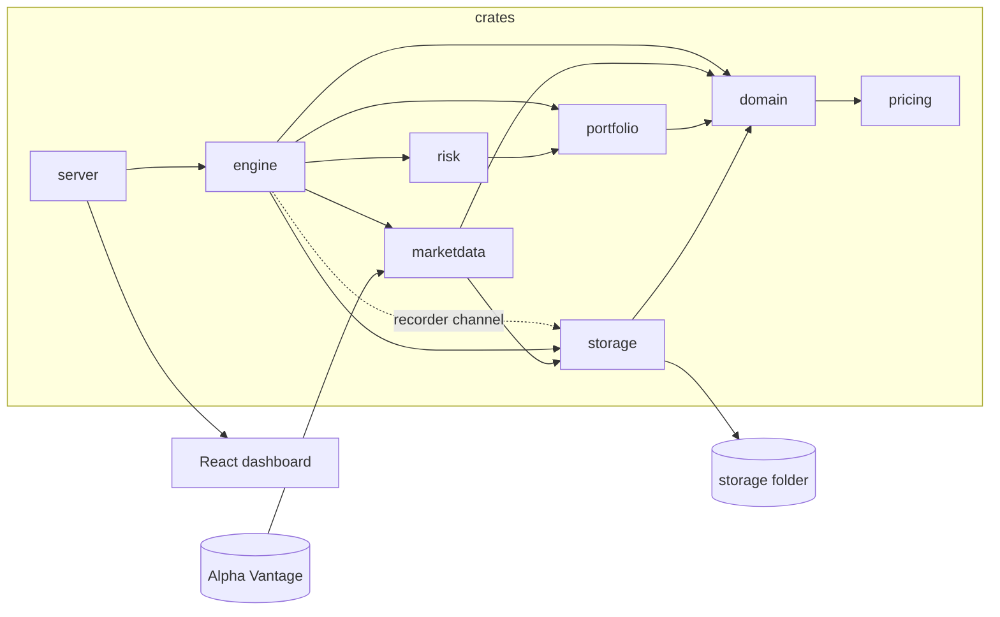
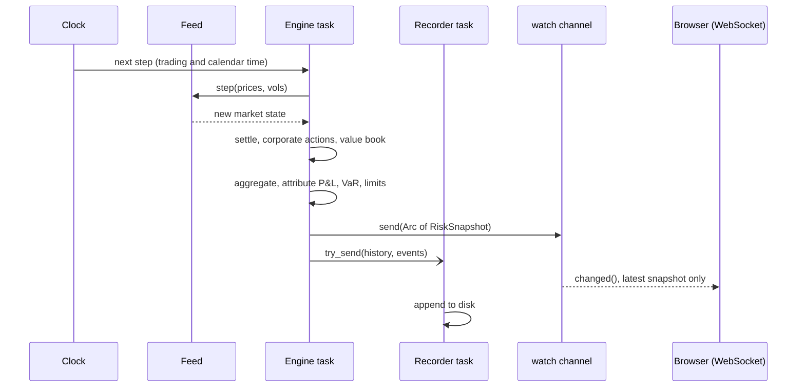

# Real-Time Risk Monitor

A real-time risk monitor for an options book. A Rust backend prices European options with Black-Scholes-Merton, computes Greeks on a live price feed, adds up the risk across the book, splits each tick's P&L into its causes, and raises alerts when a limit is crossed. A React dashboard shows it all live. The simulated prices are seeded from real market data, and everything the app produces is saved to a local folder for later review. It runs on your own machine and talks to nothing but the Alpha Vantage API.

<!-- Part 24 records docs/demo.gif and replaces this line with:  -->
> *Demo recording: coming in Part 24.*



## Features

- **Live Greeks.** Delta, gamma, vega, theta and rho for every position, plus vanna and volga, on every tick. Gamma is shown as dollar gamma, so it adds up across underlyings.
- **P&L attribution.** Each tick's P&L is split into delta, gamma, vega, theta, rho, higher-order, dividends and a residual that is shown, not hidden.
- **Three VaR methods.** Delta-normal, delta-gamma Monte Carlo and historical simulation, with expected shortfall.
- **Limits and alerts.** Eight kinds of limit with warning and breach states. Hysteresis stops alerts flickering.
- **Backtester.** Replays the same engine over real daily closes (the local archive or an uploaded file), with a VaR back-test using the Kupiec test.
- **Splits and dividends.** Stock splits adjust positions without changing their value. Discrete dividends use the escrowed model.
- **Real-data-seeded simulation.** Vols and correlations come from real closes. The risk-free rate is a Treasury yield entered by hand in `config/market.toml`. Prices then follow correlated geometric Brownian motion with mean-reverting log vol.
- **Every session saved locally.** Ticks, events, daily P&L and closing snapshots are written to disk. Five pages browse them: Live, Backtest, History, Portfolios and Data.

| Live | Backtest |
|---|---|
|  |  |

| History | Portfolios | Data |
|---|---|---|
|  |  |  |

## Quick start

The app is for localhost only. The server binds to `127.0.0.1`. Nothing is deployed anywhere.

### Docker

```bash
cp .env.example .env        # then put your Alpha Vantage key in .env
docker compose up           # or: make docker-up
```

Open <http://127.0.0.1:8080>. The container publishes its port on the loopback interface only.

### Local development

You need Rust (see `rust-toolchain.toml`) and Node.

```bash
make frontend-install       # once
make dev                    # backend on :8080 and Vite on :5173
```

Open <http://localhost:5173>. `make run` starts the backend alone, and it serves a built frontend if `frontend/dist` exists.

### API key and offline use

Put the free [Alpha Vantage](https://www.alphavantage.co/support/#api-key) key in `.env` as `ALPHA_VANTAGE_API_KEY`. The key is never written to the archive. **The app also runs offline with no key.** It then uses the local archive, and failing that the committed files in `data/fallback/`.

### Where the data goes

Runtime data lives in `../storage` next to the repo, or in the folder named by `RRM_STORAGE_DIR`. Nothing is written inside the repo, so `git status` stays clean. See [Local storage](#local-storage).

## Architecture



`pricing` has no internal dependencies. Nothing below `server` knows about HTTP, so the engine is tested without a network. The full crate-by-crate description is in [docs/ARCHITECTURE.md](docs/ARCHITECTURE.md).

One tick, from the clock to the browser:



**Single owner, no locks.** One `tokio` task owns the `Engine`. The book, the market state, the attributor and the limit monitor are plain fields with no `Mutex`. HTTP handlers only hold an `EngineHandle`. They read the latest snapshot from a `watch` channel and send commands over an `mpsc` channel that the engine task applies one at a time. A `watch` channel keeps one value and overwrites it, so a slow WebSocket client skips ticks and can never slow the engine or grow memory. Alerts use a `broadcast` channel, because a missed alert is lost information. Disk writes go through a bounded recorder channel (10,000 records) with `try_send`. A full channel drops the record and counts it, so the tick never waits on the disk.

## The maths

All rates, yields and vols are decimals (0.05 is 5 %). Rates are continuously compounded. Time to expiry $T$ is ACT/365: seconds to expiry divided by $365 \times 86{,}400$. Options expire at 16:00 New York time.

### Black-Scholes-Merton with a dividend yield

For spot $S$, strike $K$, rate $r$, continuous dividend yield $q$, volatility $\sigma$ and time to expiry $T$:

$$
d_1 = \frac{\ln(S/K) + \left(r - q + \tfrac12\sigma^2\right)T}{\sigma\sqrt{T}}, \qquad d_2 = d_1 - \sigma\sqrt{T}
$$

$$
C = S e^{-qT} N(d_1) - K e^{-rT} N(d_2), \qquad P = K e^{-rT} N(-d_2) - S e^{-qT} N(-d_1)
$$

$N(d_2)$ is the risk-neutral probability of finishing in the money. The normal CDF is computed as $N(x) = \tfrac12\operatorname{erfc}(-x/\sqrt2)$, never as $1 - N(-x)$, which loses every digit in the tail. At $T = 0$ the price is intrinsic value. As $\sigma \to 0$ it is the discounted forward intrinsic value.

### Greeks

With $\varphi$ the normal density, $\omega = +1$ for a call and $-1$ for a put:

$$
\Delta = \omega e^{-qT} N(\omega d_1), \qquad
\Gamma = \frac{e^{-qT}\varphi(d_1)}{S\sigma\sqrt T}, \qquad
\mathcal V = S e^{-qT}\varphi(d_1)\sqrt T
$$

$$
\Theta = -\frac{S e^{-qT}\varphi(d_1)\sigma}{2\sqrt T} + \omega\left[\, qS e^{-qT} N(\omega d_1) - rK e^{-rT} N(\omega d_2)\right]
$$

$$
\rho = \omega K T e^{-rT} N(\omega d_2), \qquad
\text{vanna} = -\frac{e^{-qT}\varphi(d_1)\,d_2}{\sigma}, \qquad
\text{volga} = \frac{\mathcal V\, d_1 d_2}{\sigma}
$$

`pricing` returns raw per-unit sensitivities. $\Theta$ is $\partial V/\partial t$ per year of calendar time passing, which is $-\partial V/\partial T$. From `portfolio` upwards the figures cover a whole position, with $s = \text{quantity} \times \text{multiplier}$:

| Reported figure | Formula | Unit |
|---|---|---|
| Share delta | $\Delta \cdot s$ | shares (one underlying only) |
| Dollar delta | $\Delta \cdot s \cdot S$ | dollars, adds across underlyings |
| Share gamma | $\Gamma \cdot s$ | change in share delta per $1 (one underlying only) |
| Dollar gamma 1 % | $\tfrac12 \Gamma (0.01\,S)^2 s$ | dollars, the gamma P&L of a 1 % move |
| Vega | $\mathcal V / 100 \cdot s$ | dollars per vol point |
| Theta | $\Theta / 365 \cdot s$ | dollars per calendar day |
| Rho | $\rho / 100 \cdot s$ | dollars per 1 % rate move |

#### Why share delta and share gamma do not add across underlyings

100 shares of SPY and 100 of NVDA are different things at different prices, so "200 shares of delta" means nothing. Share gamma has the same problem: a $1 move in one stock is not the same event as a $1 move in another. Dollar measures are in one currency, so they add. Dollar gamma 1 % is the P&L of a 1 % move in that stock, which is $\tfrac12 \Gamma (0.01 S)^2 s$ dollars for every stock, so the sum over underlyings is the P&L if all of them move 1 % together. That is a stated scenario, not a forecast. The `PortfolioTotals` type has no share fields, so adding them up cannot be written by accident.

### P&L attribution

Between two ticks the spot moves by $dS$, the vol by $d\sigma$ and calendar time by $dt$. With Greeks taken at the start of the tick, the second-order Taylor expansion of the value is:

$$
\Delta V \approx s\left[\Delta\, dS + \tfrac12\Gamma\, dS^2 + \mathcal V\, d\sigma + \Theta\, dt + \rho\, dr + \text{vanna}\, dS\, d\sigma + \tfrac12\,\text{volga}\, d\sigma^2\right] + \text{residual}
$$

The last two terms in the bracket form the `higher_order` bucket. The rate has no mutation path in this codebase, so $dr = 0$ and the rho bucket is always zero. `residual` is whatever is left after subtracting the modelled buckets from the true, fully revalued change. It is never computed by its own formula, so it cannot hide a mistake elsewhere. It holds the third-order and higher cross terms, the effect of a large move, and the kink when an option settles. On the day an option expires its value jumps to intrinsic, and no polynomial captures that.

The residual is small when steps are small, because the Taylor remainder is $O(dS^3)$. In the Part 9 integration test (seed 42, one session plus the overnight roll) it was 0.02 % of the total. In the backtester a step is a whole day, so it is larger: 7.6 % of the sum of absolute actual P&L in the Part 20 run. A stock has no residual, because its value is linear in spot.

On an ex-dividend date the price drops by $D$, and the holder is paid $D$ per share in cash. The cash goes into a `dividends` bucket and into `actual` together, so the residual is untouched and total P&L is continuous.

### Implied volatility

The price is strictly increasing in $\sigma$ because vega is positive, so at most one $\sigma$ solves $\text{BS}(\sigma) = \text{price}$. It exists only when the price lies between the discounted forward intrinsic value and the upper bound ($S e^{-qT}$ for a call, $K e^{-rT}$ for a put). Outside that range the solver returns a typed error.

The solver is safeguarded Newton. It starts from the Brenner-Subrahmanyam guess and keeps a bracket $[10^{-6}, 10]$:

$$
\sigma_0 = \sqrt{\frac{2\pi}{T}}\,\frac{\text{price}}{S}, \qquad
\sigma_{n+1} = \sigma_n - \frac{\text{BS}(\sigma_n) - \text{price}}{\mathcal V(\sigma_n)}
$$

If vega is below $10^{-12}$ or the Newton step leaves the bracket, it takes the midpoint instead. Plain Newton diverges for deep out-of-the-money options, where the price is almost flat in $\sigma$. The bracket makes the worst case bisection. Over 5,040 round-trip cases the mean was 8.64 iterations and the maximum 33.

### Value at Risk

All three methods report a one-day loss as a positive number, for an instant shock with no time decay. Daily vol is the current simulated vol divided by $\sqrt{252}$.

**Delta-normal.** With $\delta_i$ the dollar delta of underlying $i$ and $\Sigma_{ij} = \rho_{ij}\sigma_i\sigma_j$ the daily covariance:

$$
\text{sd} = \sqrt{\delta^\top \Sigma\, \delta}, \qquad
\text{VaR}_\alpha = \Phi^{-1}(\alpha)\,\text{sd}, \qquad
\text{ES}_\alpha = \text{sd}\,\frac{\varphi\!\left(\Phi^{-1}(\alpha)\right)}{1-\alpha}
$$

**Delta-gamma Monte Carlo.** Draw $r = L\varepsilon$ with $LL^\top$ the correlation matrix, scale by daily vol, and revalue 10,000 scenarios:

$$
\Delta P\&L = \sum_i \left[\, \delta_i r_i + \gamma_i^{1\%}\left(\frac{r_i}{0.01}\right)^2 \right]
$$

where $\gamma_i^{1\%}$ is the dollar gamma 1 % of underlying $i$. The second term is exact: $\tfrac12\Gamma S^2 r^2 s$ equals dollar gamma 1 % times $(r/0.01)^2$. The random draws are fixed (common random numbers), so an unchanged book gives an unchanged VaR instead of jittering with sampling noise.

**Historical simulation.** For each return date in the calibration window, every symbol's spot is shocked by $e^{r_t}$ and the whole book is repriced with vol held fixed (sticky strike). The window is the calibration window of 60 returns. The cap of 99 is only an upper bound. Each scenario's P&L is measured against an unshocked revaluation of the same book, so a zero-return scenario gives exactly zero.

Quantiles use linear interpolation between order statistics, $i = p(n-1)$, as NumPy and Excel's `PERCENTILE.INC` do.

**The straddle example.** Take a short at-the-money straddle with the dividend yield chosen so that $r - q + \tfrac12\sigma^2 = 0$. The call and put deltas cancel exactly, so dollar delta is zero:

| Method | VaR 99 % | Why |
|---|---|---|
| Delta-normal | $0 | sees only delta, which is zero |
| Delta-gamma Monte Carlo | about $718 | sees the negative gamma (dollar gamma 1 % is about −$69) |
| Historical | about $618 | reprices the book fully |

Delta-normal calls a flat-delta book safe. The other two see the real risk. The historical method has the opposite blind spot: it holds vol fixed, so it cannot see vega risk.

**Kupiec test.** An exception is a day whose loss exceeds the start-of-day VaR. With $p = 0.01$, $n$ days and $x$ exceptions:

$$
LR = -2\ln\!\left[(1-p)^{n-x}p^{x}\right] + 2\ln\!\left[\left(1-\tfrac xn\right)^{n-x}\left(\tfrac xn\right)^{x}\right], \qquad
\text{p-value} = P\!\left(\chi^2_1 > LR\right) = \operatorname{erfc}\!\sqrt{LR/2}
$$

with $0\ln 0 = 0$. Part 20 ran it on the local archive on 2026-09-30 (80 replay days, 2026-06-04 to 2026-09-28): **3 exceptions against 0.8 expected, $LR = 3.59$, p = 0.058**, so not rejected at 5 %. The number of days grows as more data is fetched. **The test has almost no power at this size.** At $n = 80$ it rejects only from 4 exceptions, and a model whose true exception rate is 3 % is caught 22 % of the time. A rejection means something. A pass does not. Upload a few years of closes for a real back-test.

### The simulation model

Prices follow correlated geometric Brownian motion with an exact log step. For a step of $h$ trading years:

$$
S_{t+h} = S_t \exp\!\left[\left(\mu - \tfrac12\sigma^2\right)h + \sigma\sqrt h\, Z\right], \qquad Z = L\varepsilon
$$

$L$ is the Cholesky factor of the correlation matrix ($LL^\top = C$) and $\varepsilon$ is a vector of independent standard normals. The step is exact for constant $\sigma$, so there is no discretisation error, any step size gives the same distribution, and the price cannot go negative. If $C$ is not positive definite it is shrunk towards the identity, $C' = (1-\lambda)C + \lambda I$, in steps of 0.05.

Log vol $x = \ln\sigma$ is an Ornstein-Uhlenbeck process, pulled back to the calibrated vol $\bar x$:

$$
x_{t+h} = \bar x + (x_t - \bar x)e^{-\kappa h} + \xi\sqrt{\frac{1 - e^{-2\kappa h}}{2\kappa}}\; W, \qquad W = \rho Z + \sqrt{1-\rho^2}\,\eta
$$

Working in logs keeps vol positive and makes it right-skewed, as real vol is. The **leverage correlation** $\rho = -0.7$ (`config/simulation.toml`) makes vol rise when the price falls, which skews returns and makes out-of-the-money puts dearer than calls.

**Trading time against calendar time.** Vols are annual figures over 252 trading days of 6.5 hours, so diffusion uses trading time. Option expiry and theta use ACT/365 calendar time. An overnight or weekend step has no trading time, so nothing diffuses, but its calendar time is large. Monday's first tick therefore carries the weekend's theta.

### Splits and the escrowed dividend model

A split must leave a holding's value unchanged. For a ratio $r$ (2 is 2-for-1, 1.5 is 3-for-2):

- A stock: quantity $\times\, r$, entry price $\div\, r$.
- An option on a whole-number ratio: contracts $\times\, r$, strike $\div\, r$.
- An option on any other ratio: contracts unchanged, multiplier $\times\, r$, strike $\div\, r$. A 3-for-2 split leaves 150-share contracts.
- Entry price $\div\, r$ in both option cases. BSM is homogeneous of degree one in $(S, K)$, so value and Greeks are unchanged.

For a symbol on the discrete dividend model, the option is priced on spot less the present value of dividends going ex before expiry, with $q = 0$:

$$
S^* = S - \sum_i D_i\, e^{-r\tau_i}, \qquad \tau_i = \text{time to ex-date } i
$$

Spot sensitivities equal those with respect to $S^*$. Time and rate change, because the escrow accretes at $r$. With $PV = \sum_i D_i e^{-r\tau_i}$:

$$
\Theta = \Theta_{BS}(S^*) - \Delta\, r\, PV, \qquad
\rho = \rho_{BS}(S^*) + \Delta \sum_i \tau_i D_i e^{-r\tau_i}
$$

Both corrections are checked against finite differences. The model has a known weakness: vol applies only to $S^*$, which understates long-dated options on stocks with large dividends. Fixes exist and are not built (see [Limitations](#limitations-and-future-work)).

## Limits

Utilisation is $u = |\text{value}| / \text{limit}$. The theta floor is the exception: it compares the limit with $\max(0, -\Theta)$, so a book earning theta can never breach it.

- **Warning** from $u \ge 0.8$. **Breach** from $u \ge 1$.
- **Hysteresis.** Entering a state is instant. Leaving it needs a real retreat. A breach clears only below $u = 0.95$, and it then lands at Warning. Warning clears only below $u = 0.75$. A value sitting on a line therefore cannot flicker.

| Limit | Default | What it protects against |
|---|---|---|
| Portfolio dollar delta | 550,000 | A large directional bet. Set tight on purpose: the sample book's stock alone carries about $490,000, so it is the demo's one permanent breach. |
| Portfolio dollar gamma 1 % | 9,500 | Delta that moves fast in a 1 % shock, which is the cost of staying hedged. |
| Portfolio vega | 2,200 | Exposure to implied vol moves, in dollars per vol point. |
| Theta floor | 4,500 | A daily time-decay bill that is too large. |
| Gross exposure | 2,700,000 | Offsetting positions hiding real size. Sum of absolute dollar delta. |
| Max concentration | 0.55 | One underlying dominating gross exposure. |
| Per-underlying dollar delta | 150,000 default; MSFT 500,000, SPY 1,000,000, TSLA 74,000 | One big single-stock bet hiding in a flat total. TSLA's is a demo trigger that crosses and clears during a session. |
| 99 % VaR (`var_99`) | 32,500 | A one-day loss above what the book was measured to risk. About 30 % above the peak seen in 10 tuning sessions. |

Most defaults were tuned for the simulated sample book, so a real book needs its own numbers. On real history this file is in breach on most days (58 of 80 in the Part 20 run).

## Testing

Test counts at tag `part-22-r2`: **631 Rust and 244 frontend** tests. Part 23 added 2 frontend tests, so 246 now.

- **Reference values.** Prices and Greeks are checked against mpmath to 1e-10, and against worked examples from Hull and Haug.
- **Finite differences.** Every Greek is compared with a central difference, using bump sizes that balance truncation and round-off. A planted 1e-5 error in volga is caught.
- **Property tests (`proptest`).** Put-call parity, no-arbitrage bounds, monotonicity, implied vol round trips (300,000 random draws) and the sums in risk aggregation.
- **Statistics.** Simulator tests use fixed seeds. The Kupiec test is checked against values computed independently in Python.
- **Safety.** `unwrap`, `expect`, `panic`, `todo` and `unimplemented` are denied by clippy outside tests. Tests use `tempfile` directories and never touch the real storage folder.

```bash
make check      # cargo fmt --check, clippy -D warnings, cargo test --workspace
make ci         # make check, the generated-types check, the frontend checks and a Docker build
```

## Performance

Measured on the development machine, **[CPU model: to be confirmed by the author]** running Linux. The criterion rows are the figures logged during the build. The two rows marked "to be re-measured in phase B" are measured against the release Docker image with `scripts/measure-compute.sh`, which samples for 2 minutes and prints the median and p99.

| What | Result | Build |
|---|---|---|
| One `greeks()` call (criterion) | 40.8 ns | release |
| 10,000 varied options (criterion) | 441 µs, 44.1 ns each, 22.7 million options a second | release |
| Implied vol, near the money (criterion) | 160 ns | release |
| Implied vol, deep out of the money (criterion) | 762 ns | release |
| `compute_micros`, whole tick, VaR included (5 symbols) | to be re-measured in phase B | release (Docker image) |
| VaR `total_compute_micros`, all three methods, fresh ticks only | to be re-measured in phase B | release (Docker image) |

A tick has a 250 ms budget and VaR has a 1 ms budget. If its warm-up median is over budget it recomputes every 2 to 10 ticks. That did not trigger in the Part 12 measurements.

## Local storage

Runtime data lives under the storage folder (`../storage`, or `RRM_STORAGE_DIR`):

```
storage/
  market-data/{SYMBOL}/<ts>-daily.json      every Alpha Vantage download: raw body, fetch time, parameters
  portfolios/current.json                   the live book, rewritten atomically on every change
  portfolios/versions/<ts>-<slug>.csv       saved versions, never overwritten
  portfolios/applied-actions.jsonl          ledger of splits and dividends already applied
  sessions/<session_id>/meta.json           start and end, seed, speed, git commit, dropped records
  sessions/<session_id>/config/             copies of the config files the session used
  sessions/<session_id>/history.jsonl       one point per tick
  sessions/<session_id>/events.jsonl        alerts, settlements, position changes, control actions
  sessions/<session_id>/daily-pnl.csv      one row per simulated day, every P&L bucket
  sessions/<session_id>/closes/<date>.json  full snapshot at each session close
  backtests/<run_id>/                       input.csv, settings.json, daily.csv, events.jsonl, summary.json, config/
```

Times in file names are UTC, `YYYYMMDDTHHMMSSZ`, so they sort in time order.

**Crash safety.**
- JSON files are written to a temp file in the same folder, synced, then renamed. A crash leaves the old file or nothing, never half a file.
- JSONL logs are append-only and flushed at least once a second. A truncated last line is skipped with a warning. A broken line earlier in the file is a hard error.
- A `meta.json` with no end time means the session was cut short. Readers treat it as unfinished, not as bad data.
- Disk writes happen on the recorder task, never on the tick.
- The app deletes nothing unless you trigger a delete. Only **backtest run folders** can be deleted, from the Backtest page, and the run id must be typed back to confirm.

**Size.** `config/storage.toml` sets a soft ceiling of 20 GiB. At 80 % the app logs a warning and sets a flag on `/api/health` and `/api/storage`. It never deletes anything to make room. A live session measured about **8.56 MB per real hour** (946,747 bytes in 398 seconds), almost all of it `history.jsonl`.

**Storage browser.** The History page lists saved sessions, charts one session, and compares two. Portfolios lists saved versions, shows a diff against the live book before loading, and exports. Data shows the market-data archive, folder sizes and the usage warning. All three only read, apart from loading a portfolio version.

## API

Errors are JSON, `{"error":{"code":"not_found",...}}`. An unknown `/api/...` path gives a real 404.

| Route | Purpose |
|---|---|
| `GET /api/health` | Status, uptime, last tick age, WebSocket clients, dropped records, storage warning |
| `GET /api/positions` | Valued positions |
| `POST /api/positions` | Add a position |
| `DELETE /api/positions/{id}` | Remove a position |
| `GET /api/greeks` | Greeks per position |
| `GET /api/risk-summary` | Per-underlying and portfolio totals |
| `GET /api/pnl` | P&L attribution, today and since start |
| `GET /api/var` | The three VaR methods |
| `GET /api/alerts` | Active alerts and history |
| `POST /api/control` | `{"action":"pause"}`, `resume`, or `{"action":"set_speed","speed":120}` |
| `GET /api/history` | Recent ticks (optional `since` sequence number) |
| `GET /api/storage` | Storage usage by folder |
| `GET /api/sessions`, `/api/sessions/{id}` | Saved sessions |
| `GET /api/sessions/{id}/history`, `/events` | A saved session's ticks and events |
| `GET /api/portfolio/versions`, `POST` | List or save portfolio versions |
| `GET /api/portfolio/versions/{file}`, `/specs` | Read a version |
| `POST /api/portfolio/versions/{file}/load` | Replace the live book with a version |
| `GET /api/market-data/archive`, `/archive/{symbol}/{file}/closes` | The download archive |
| `GET /api/backtests`, `POST /api/backtests` | List or start a run |
| `GET /api/backtests/archive-coverage` | Dates the archive can replay |
| `GET /api/backtests/{id}`, `/results` | Run status and results |
| `POST /api/backtests/{id}/control` | `play`, `pause`, `step`, `set_speed`, `run_to_end` |
| `DELETE /api/backtests/{id}` | Stop a run and free its memory (files stay) |
| `DELETE /api/backtests/{id}/files` | Delete a saved run's folder (id typed back) |
| `GET /ws` | Live WebSocket stream |
| `GET /ws/backtests/{id}` | Replay stream, same protocol |

**WebSocket.** One JSON object per text frame, tagged by `type`. The server sends:

```json
{"type":"hello","protocol_version":1,"server_version":"0.1.0","tick_interval_ms":250,"speed":120.0}
{"type":"snapshot","snapshot":{"seq":1042,"compute_micros":199,"...":"the full RiskSnapshot"}}
{"type":"alert","alert":{"id":3,"name":"underlying_dollar_delta","scope":{"kind":"underlying","symbol":"TSLA"},"from":"ok","to":"warning","value":59800.0,"limit":74000.0,"...":"times omitted"}}
{"type":"resync","reason":"alert stream lagged"}
{"type":"error","message":"invalid subscribe"}
```

The values in these examples are illustrative. A snapshot for the sample book is about 24.5 KB of JSON. The client may send one message, which caps the snapshot rate (hard cap 10 Hz):

```json
{"type":"subscribe","max_hz":2}
```

The server pings every 15 seconds and closes the socket if no pong arrives within 30 seconds. The TypeScript types in `frontend/src/api/generated/` are generated from the Rust types (`make types`), so they cannot drift from the wire format.

## Limitations and future work

- **European exercise only.** American options, with early exercise, are not priced. This matters for puts and for calls before a dividend.
- **Flat vol per underlying.** There is no skew or term structure, so out-of-the-money options are priced at the at-the-money vol.
- **No exchange holidays.** The simulated clock trades on days the real market is shut.
- **Cash settlement.** An expiring option pays its intrinsic value in cash. Real equity options deliver shares.
- **Historical VaR is sticky-strike with no vol shocks.** It cannot see vega risk, and its 99 % level rests on at most 60 points.
- **Escrowed dividends understate long-dated options** on stocks with large dividends, because vol applies only to $S^*$. The Haug-Haug-Lewis, Bos-Vandermark and Beneder-Vorst models fix this and are not built.
- **Adjusted strikes are not rounded** to listed increments as the OCC does. A 3-for-2 split on a 240 strike gives 160, and on 200 gives 133.33.
- **The split detector can be fooled.** A real one-day fall of about 33 % is read as a 3-for-2 split. It is logged as a warning.
- **The backtester uses closes only.** Vol is 20-day realised vol, so vega P&L is realised-vol change. Its P&L residual is larger than in live mode because a step is a day.
- **Implied vol uses safeguarded Newton.** Jäckel's "Let's Be Rational" is the production method and is faster and more accurate in the extreme tails. It is not built.
- **Plain files in place of a database.** Files are simple to inspect and back up. They give no indexes or queries, and the History page reads whole files.
- **Local only.** There is no authentication because the server only listens on `127.0.0.1`. A cloud deployment is planned and would need authentication, a database and secrets handling first.

## Development history

The project was built in numbered parts. Each part ends with a commit and a tag `part-NN`, and a re-run gets `part-NN-r2`. History is never rewritten and tags never move.

```bash
make history                  # recent commits and tags
git checkout part-10          # look at the code as it was after Part 10
git checkout main             # come back
make snapshot                 # compressed copy of HEAD in ../snapshots/
```

`make snapshot` refuses to run on a dirty tree, so every archive in `../snapshots/` matches a commit. The build plan is in [docs/ROADMAP.md](docs/ROADMAP.md), the log in [docs/PROGRESS.md](docs/PROGRESS.md) and the per-part maths and design notes in [docs/notes/](docs/notes/).

## Data

Daily closes come from the [Alpha Vantage](https://www.alphavantage.co/) `TIME_SERIES_DAILY` endpoint (raw, as-traded closes). The free tier allows 25 requests a day, so every download is saved to `market-data/{SYMBOL}/` and never overwritten, and the app does not fetch on every start. For each symbol it tries a fresh archive file, then the API, then the newest archive file of any age, then the committed `data/fallback/{SYMBOL}.csv`. Over time the archive becomes a local price history, which the backtester replays. The risk-free rate and dividend yields are set by hand in `config/market.toml`, with their sources in comments there. The rate is the 3-month US Treasury par yield of 2026-09-25, converted to a continuous rate.

## Licence

MIT. See [LICENSE](LICENSE).
