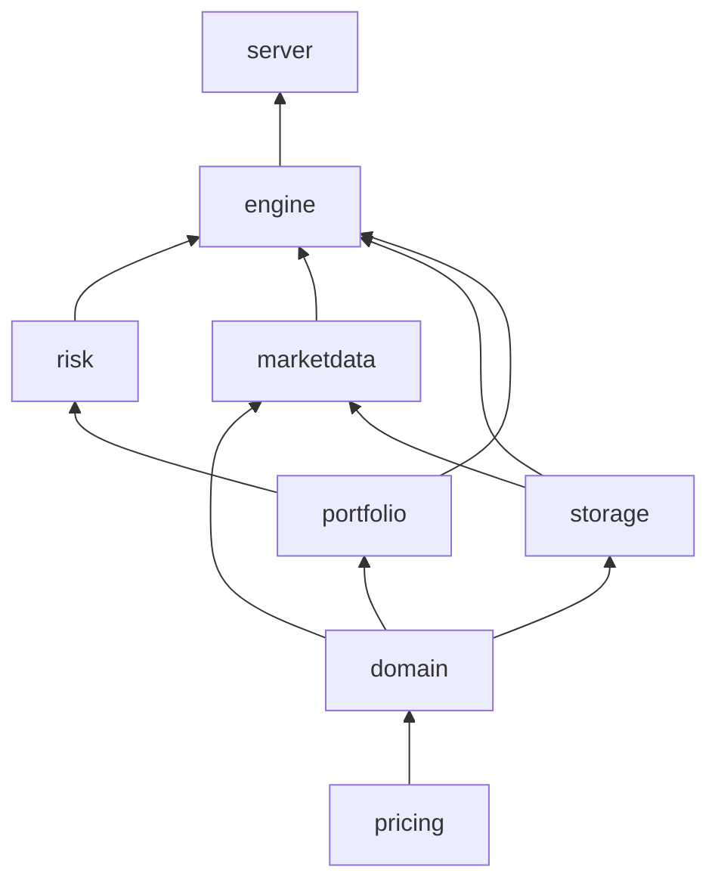

# Architecture

How the Real-Time Risk Monitor fits together. The README has the maths. This page has the structure.

## Crates

| Crate | Job | Depends on |
|---|---|---|
| `pricing` | Pure maths: normal distribution (CDF, density, inverse CDF), BSM price, Greeks, implied vol. No I/O, no allocation on the hot path. | nothing internal |
| `domain` | Shared types: `Symbol`, instruments, validated `MarketState`, the clock traits, ACT/365 time. | `pricing` |
| `storage` | Storage root, folder layout, atomic JSON writes, append-only JSONL, readers, usage, confined folder removal. Generic over serde types. No HTTP. | `domain` |
| `portfolio` | Positions, the position book, CSV loading, relative strikes and expiries, valuation, reporting Greeks, split adjustment. | `domain` |
| `marketdata` | Alpha Vantage fetch, the download archive, fallback files, calibration, the simulator, the market clock, replay feed and clock. | `domain`, `storage` |
| `risk` | Aggregation, P&L attribution, limits and alerts, VaR, the Kupiec test. | `portfolio` (and `pricing`) |
| `engine` | The tick loop, snapshots, session recorder, corporate actions, the backtest runner. No HTTP. | all of the above |
| `server` | axum REST and WebSocket, config loading, static files, the `risk-monitor` binary. | `engine` |
| `frontend/` | React, Vite, TypeScript dashboard. Types are generated from Rust by `ts-rs`. | the HTTP API |

There are no cycles. Nothing below `server` knows about HTTP, so the engine is tested without a network. `server` has a library and a binary so tests can build the router.

## The tick pipeline

`Engine::tick` runs these steps in order, once per step of the clock:

1. **Clock.** The clock gives the step: its end time, trading years (for diffusion) and calendar years (for expiry and theta), and a kind (`Open`, `Intraday`, `Overnight`). A paused clock produces no step.
2. **Feed.** The feed moves spot and vol. On error, prices stay as they were and the snapshot is marked degraded. Time still moves, so settlement and the day roll continue.
3. **Corporate actions.** On an overnight step, due splits and dividends are applied to the book, the market and the attributor.
4. **Settlement.** Options past their 16:00 New York expiry are cash-settled and kept for display with zero Greeks.
5. **Valuation.** `value_all` prices every position and gives reporting Greeks. A bad position becomes an error row with zeros and never stops the book.
6. **Aggregation.** `risk::aggregate` folds the rows into per-underlying and portfolio dollar measures.
7. **P&L attribution.** `PnlAttributor` splits the change since the previous tick into buckets. The residual is the remainder.
8. **VaR.** `VarCalculator` runs the three methods, possibly every few ticks if the 1 ms budget needs it.
9. **Limits.** `LimitMonitor` evaluates every limit with hysteresis and emits alert events.
10. **Publish.** The engine builds an immutable `RiskSnapshot`, sends it on the `watch` channel, sends alerts on the `broadcast` channel, and hands history points and events to the recorder with `try_send`.

A backtest runs the same `tick`. Only the clock (`ReplayClock`) and the feed (`ReplayFeed`) differ, and both are behind traits.

## Concurrency and back-pressure

- One `tokio` task owns the `Engine`. It has no `Mutex` or `RwLock`.
- Handlers read with `watch::Receiver::borrow()`. They write by sending a command over `mpsc` with a `oneshot` reply.
- **Snapshots use `watch`.** One slot, always overwritten. A slow client skips ticks. Memory is bounded by the number of clients, not missed ticks. The client's `max_hz` throttle sits on top, with a trailing flush so the last change is never lost.
- **Alerts use `broadcast`.** Every subscriber needs every event. A lagged client gets a `resync` message and a fresh snapshot.
- **The recorder uses a bounded `mpsc` (10,000) with `try_send`.** A full channel drops the record and counts it. The count is in `meta.json` and `/api/health`.
- Portfolio version files are read and written in the HTTP handlers, off the tick path.
- Shutdown stops ticks, drains the recorder, flushes the JSONL writers, writes the final `meta.json`, then exits.

## Recorder and storage layout

The recorder task is the only place in the engine crate that touches disk. It writes `history.jsonl`, `events.jsonl`, `daily-pnl.csv`, `closes/<date>.json`, `meta.json` and `portfolios/current.json`. JSON goes through temp file, fsync and rename. JSONL is append-only, flushed at least once a second. The folder tree is in the README under "Local storage". Settled positions are left out of `current.json` so a restart cannot pay them out twice.

## Error handling

- Library crates define `thiserror` enums. Only `main` in `server` uses `anyhow`.
- No `unwrap`, `expect`, `panic!`, `todo!` or `unimplemented!` outside tests. Clippy denies them. `unsafe` is forbidden.
- Inputs are validated at crate boundaries. `BsInputs`, `Symbol`, `UnderlyingState` and `MarketState` cannot hold NaN, and deserialising goes through the same checks.
- Failures are contained at the smallest scope: one position becomes an error row, one symbol's feed fault freezes prices not time, one unreadable old session is skipped in a list.
- API errors are `{"error":{"code":...,"message":...}}` with a matching HTTP status.

## Where each part's decisions live

| Part | Topic | Code | Note |
|---|---|---|---|
| 1 | Workspace, lints | `Cargo.toml`, `clippy.toml` | `docs/notes/part-01-workspace.md` |
| 2–4 | BSM, Greeks, implied vol | `crates/pricing` | parts 02, 03, 04 |
| 5 | Domain types, position book | `crates/domain`, `crates/portfolio` | part 05 |
| 6 | Aggregation | `crates/risk/src/aggregate.rs` | part 06 |
| 7 | Market data, calibration | `crates/marketdata` | part 07 |
| 8 | Simulator and clock | `crates/marketdata/src/simulator.rs`, `clock.rs` | part 08 |
| 9 | P&L attribution | `crates/risk/src/attributor.rs`, `pnl.rs` | part 09 |
| 10 | Limits and alerts | `crates/risk/src/monitor.rs`, `limits.rs`, `config/limits.toml` | part 10 |
| 11 | Engine and REST | `crates/engine`, `crates/server/src/routes.rs` | part 11 |
| 12 | WebSocket | `crates/server/src/ws.rs` | part 12 |
| 13 | Storage and recording | `crates/storage`, `crates/engine/src/recorder.rs` | part 13 |
| 14–16 | Frontend | `frontend/src` | parts 14, 15, 16 |
| 17 | Docker | `Dockerfile`, `docker-compose.yml` | part 17 |
| 18 | VaR | `crates/risk/src/var` | part 18 |
| 19 | Splits and dividends | `crates/portfolio/src/split.rs`, `crates/engine/src/corporate.rs` | part 19 |
| 20 | Backtester | `crates/engine/src/backtest`, `crates/risk/src/backtest.rs` | part 20 |
| 21 | Backtester UI | `frontend/src/components/backtest` | part 21 |
| 22 | Storage browser | `crates/server/src/storage_routes.rs`, `frontend/src/components/storage` | part 22 |
| 23 | Documentation | `README.md`, this file | part 23 |
